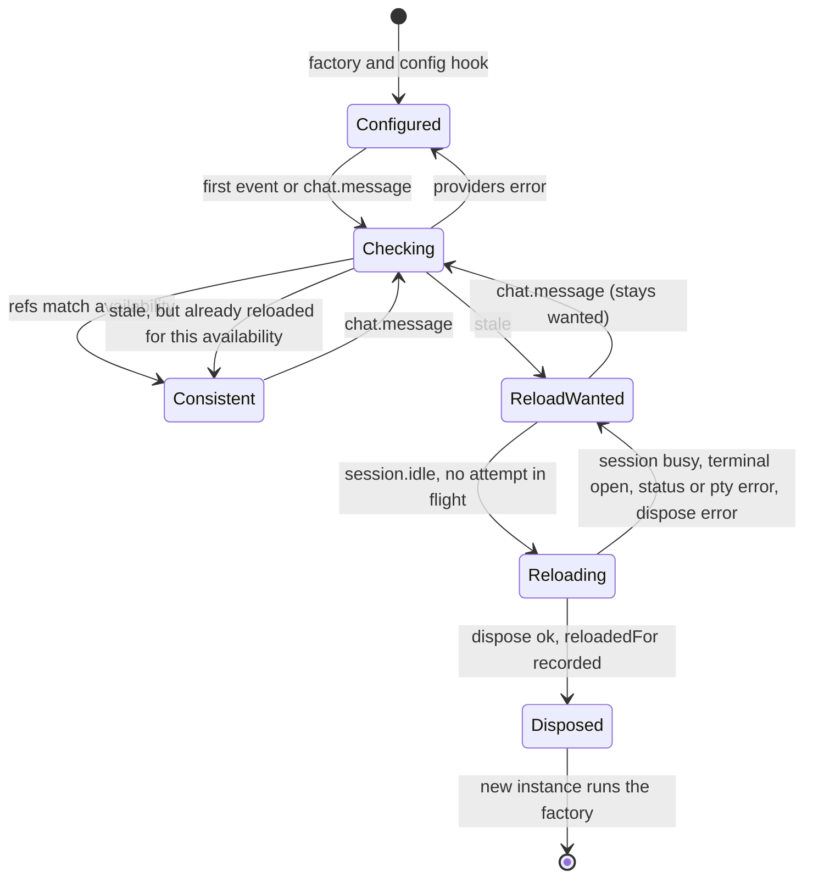
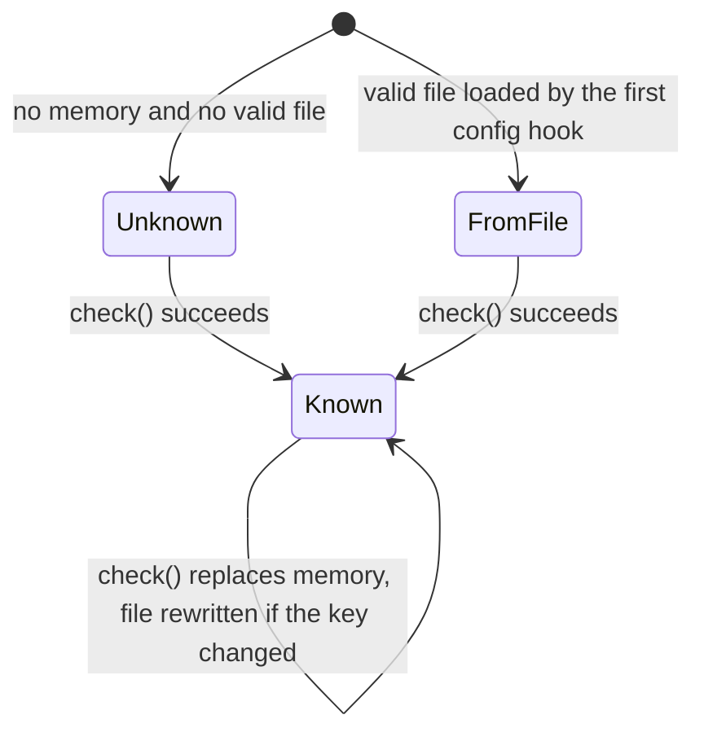
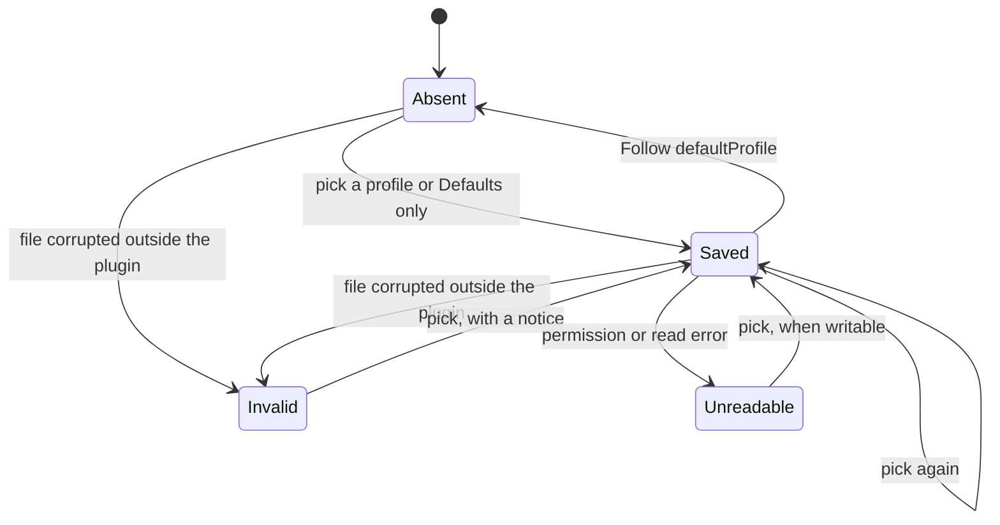
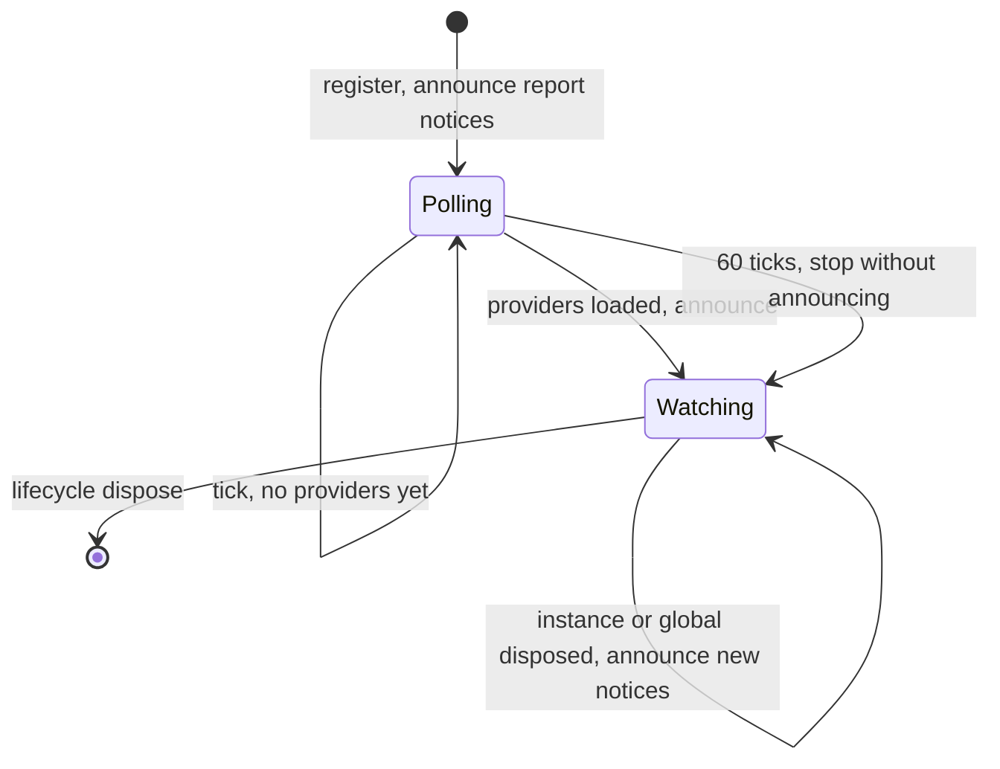
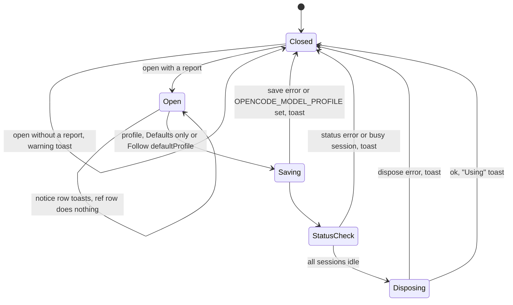

# State machines

This document describes the state Model Profiles keeps across hooks, events and reloads. Update it in the same PR as any change to these states, their triggers or their exits, following the [state machine conventions](https://github.com/lunchbox-labs/.github/blob/main/agent-guidance/state-machines.md). Known bugs belong in issues, not here.

The server plugin's factory runs once per instance load, so closure state is rebuilt on every reload. Module-level state and files in the state directory survive reloads; files are also shared with other OpenCode processes.

## Fallback and reload controller

`createFallbacks` in `src/server.ts` keeps per-instance closure state:

- `applied`: what the config hook applied (assignments, `configuredModel`, `configuredProviders`).
- `checkedOnce`: whether the first-event availability check was scheduled.
- `lastAvailable`: the last provider and model set this instance saw.
- `reloadWanted`: the applied refs no longer match availability.
- `reloading`: a reload attempt is in flight.
- `sessionModels`: each session's model after the hook, for subagent fallback; entries are removed on `session.deleted`.

The module-level `reloadedFor` map (directory to availability key) records the availability of the last successful reload per directory, so the same availability never triggers a second reload in one process.

Transitions:

- The config hook sets `applied`. If resolution throws, nothing is applied, `modelRef` is stripped and a notice is published.
- The first event of any type sets `checkedOnce` and schedules `check()`. Every `chat.message` also runs `check()` through `checkMessage`.
- `check()` reads `config.providers`, saves availability and sets `reloadWanted` when `assignmentsAreStale` reports a mismatch and `reloadedFor` does not already hold the current availability key. A provider error changes nothing.
- `session.idle` calls `scheduleReload`, which does nothing unless `reloadWanted` is set and no attempt is in flight. Only `session.idle` schedules a reload.
- `reloadWhenIdle` gives up for this attempt, leaving `reloadWanted` set, if `session.status` or `pty.list` errors, a session is not idle or a terminal is open. Otherwise it disposes the instance; on success it clears `reloadWanted` and records `reloadedFor`, and on a dispose error `reloadWanted` stays set.
- A successful dispose ends this closure. The host builds a new instance, whose config hook reads the saved availability.

## Availability cache

`src/fallback.ts` keeps availability in memory (`availability`, keyed by directory) and in `<state>/model-profiles/available/<hash of directory>.json`.

- `knownAvailableModels` reads memory first, then a valid file (loading it into memory), else returns unknown, in which case every ref is applied.
- `rememberAvailableModels` always replaces memory, and writes the file through a temporary file and rename only when the availability key changed or the ref-model set grew. Write errors are ignored.
- Memory always wins within a process. Between processes the file is last writer wins, and a process does not reread a file another process wrote.

## Ref-model registry

`refModels` in `src/fallback.ts` holds every model a ref has put on an agent. It is unioned on every check, saved with availability and loaded from the file only when memory has none. It only grows. `checkMessage` reroutes a prompt off a model in this set when the model is unavailable and OpenCode took it from the agent or session.

## Profile selection

Resolution in `src/resolution.ts` is a pure function of `OPENCODE_MODEL_PROFILE` (read once per process in `src/selection.ts`), the saved selection, `defaultProfile` and the defaults, in that order. Unknown profiles are skipped with a notice.

The saved selection is `<state>/model-profiles/worktrees/<hash of worktree>.json`. Only the TUI writes it: `saveSelection` through a temporary file and rename, and `clearSelection` for "Follow defaultProfile". The server config hook and the TUI dialog read it with `readSavedSelection`. A saved choice stays pending until the next instance load, whichever reload causes it.

## TUI notices and provider poll

`registerModelConfig` in `src/tui.ts`:

- `shownNotices` is replaced with the current notice set on every read, and a notice is toasted when the previous read did not have it, so a notice that goes away and comes back is toasted again.
- `reading` chains reads so they never overlap; read failures are absorbed.
- `providerTimer` polls `api.state.provider` every 500 ms until the list is non-empty, then announces, or stops after 60 ticks without announcing.
- `announceFallbacks` runs at startup, from the poll, on `server.instance.disposed` for this directory while `reloadsInFlight` is zero, and on `global.disposed`.

## /model-config dialog and pick

In `src/tui.ts`, a notice row toasts its full text and keeps the dialog open, and a ref row does nothing. A profile, Defaults only or Follow defaultProfile row closes the dialog and runs `choose`:

- `choose` saves or clears the selection, toasting and stopping on an error. With `OPENCODE_MODEL_PROFILE` set it toasts that the variable still applies to this process and stops. Otherwise it calls `reload`, and toasts that the choice applies on the next reload if `reload` throws.
- `reload` toasts and stops if `session.status` errors or any session is busy. Otherwise it increments `reloadsInFlight`, disposes the instance, decrements it, and toasts the profile in use and any new notices, or a warning on a dispose error. It does not check terminals.

## Event ordering

The server `event` hook is synchronous. The first check and every reload attempt are deferred with `setTimeout` and end in `.catch`, and `chat.message` swallows any throw from `check()` and `parentModel()`, so no hook or event can fail the host.
