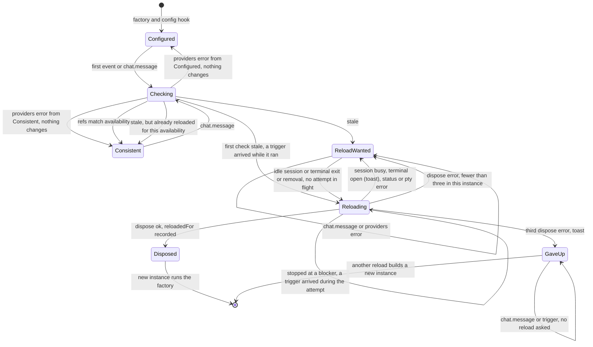
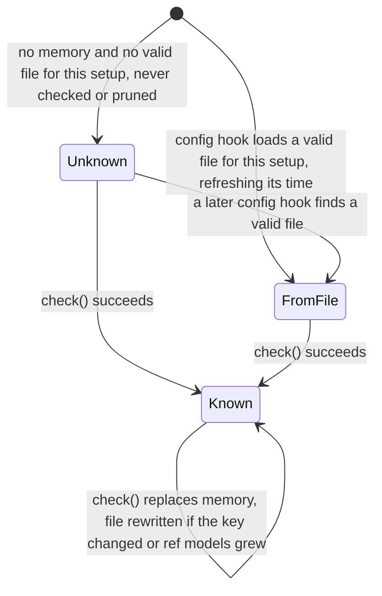
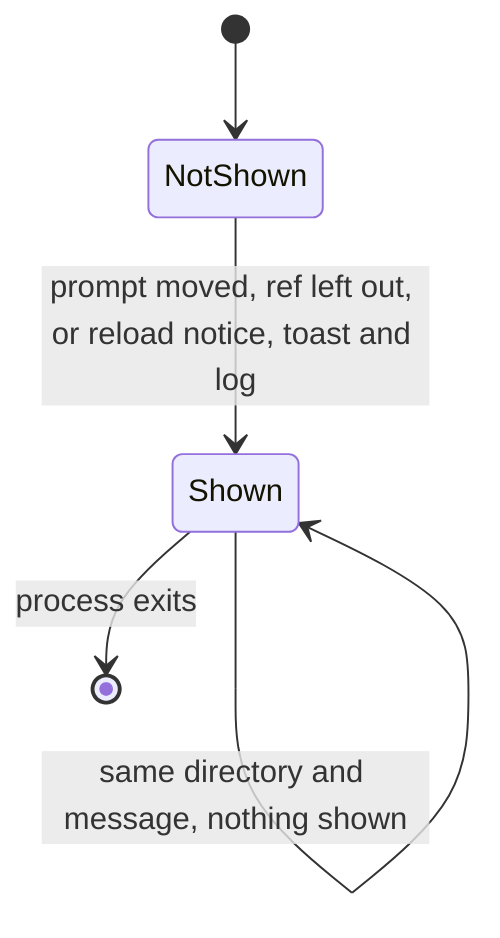
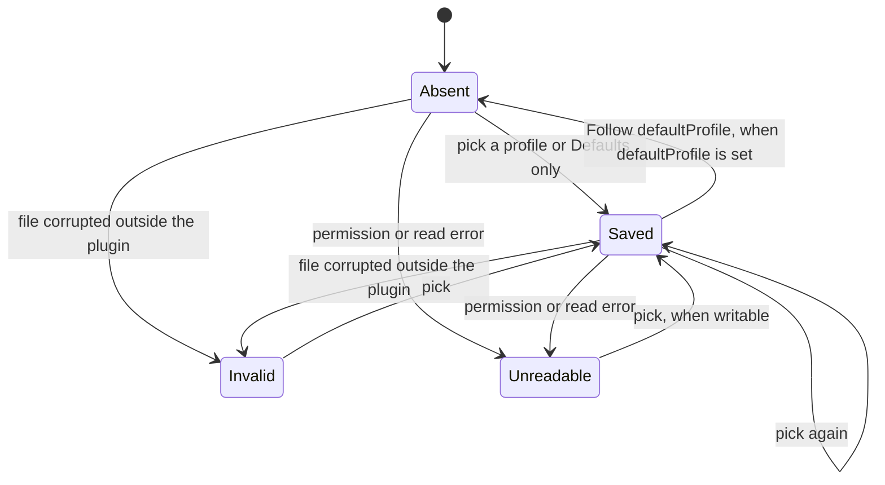
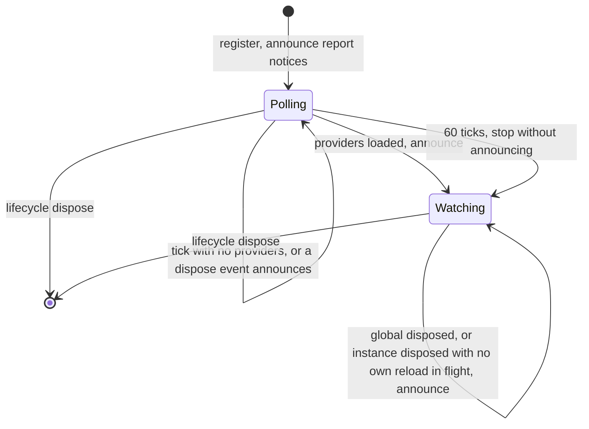
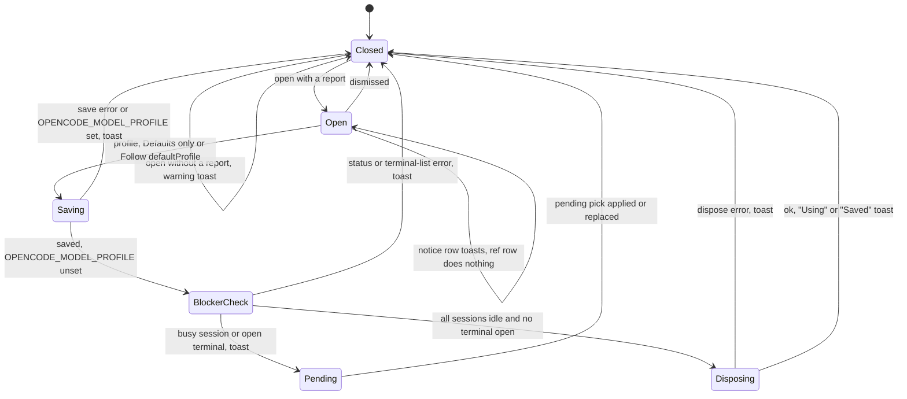
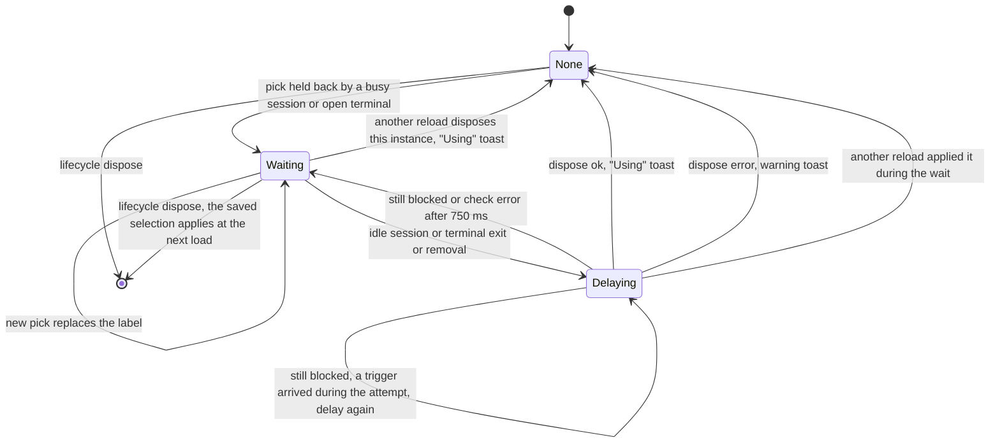
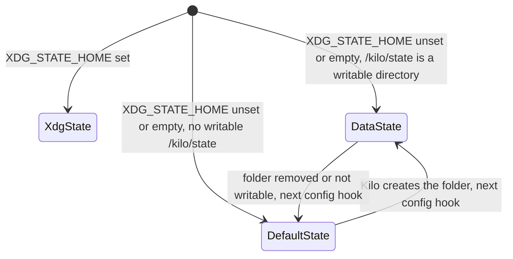

# State machines

This document describes the state Model Profiles keeps across hooks, events and reloads. Update it in the same PR as any change to these states, their triggers or their exits, following the [state machine conventions](https://github.com/lunchbox-labs/.github/blob/main/agent-guidance/state-machines.md), and cover each transition you add or change in the tests under `packages/*/tests`. Known bugs belong in issues, not here.

The server plugin's factory runs once per instance load, so closure state is rebuilt on every reload. The core holds every machine below, and each host package runs it with its own `Host` profile, so OpenCode and Kilo processes run the same machines over separate directories and variables. This document uses OpenCode's names; [Host paths](#host-paths) gives Kilo's.

Module-level state and files in the state directory survive reloads; files are also shared with other processes of the same host.

## Fallback and reload controller

The server plugin in `packages/core/src/server.ts` keeps `applied`, what its config hook applied (assignments, `handSetModels`, `configuredModel`, `configuredProviders`), and passes a getter for it to `createFallbacks`, which keeps per-instance closure state:

- `checkedOnce`: whether the first-event availability check was scheduled.
- `firstCheckPending`: that check has not settled yet.
- `reloadRequestedDuringFirstCheck`: a reload trigger arrived while the first check was pending and no reload was wanted yet.
- `lastAvailable`: the last provider and model set this instance saw.
- `reloadWanted`: the applied refs no longer match availability.
- `reloading`: a reload attempt is in flight.
- `reloadRequestedWhileReloading`: a reload trigger arrived during the attempt in flight.
- `failedReloads`: disposes the host refused in this instance; at three (`reloadAttemptLimit`) the instance stops asking.
- `sessionModels`: each session's model after the hook, for subagent fallback; entries are removed on `session.deleted`.

The module-level `reloadedFor` map (directory to availability key) records the availability of the last successful reload per directory, so the same availability never triggers a second reload in one process. The module-level `toastedFallbacks` set (directory and message) records the fallback and reload toasts already shown, so each appears once per process. The closure state resets on each instance load; `reloadedFor` and `toastedFallbacks` last until the process exits.

Transitions:

- The config hook sets `applied`, including `providerSetup`, the provider setup key described under Availability cache. `handSetModels` holds each agent's own `model` when no applied ref gave that agent its model. If resolution throws, nothing is applied, `modelRef` is stripped and a notice is published.
- The first event of any type sets `checkedOnce` and `firstCheckPending` and schedules `check()`. Every `chat.message` also runs `check()` through `checkMessage`, so the two can run at the same time.
- `check()` reads `config.providers`, saves availability for `providerSetup` (nothing is saved when the config hook failed and left it unset) and then sets `reloadWanted` when fewer than three disposes were refused, `assignmentsAreStale` reports a mismatch and `reloadedFor` does not already hold the current availability key. A provider error returns early and changes nothing. `check()` never clears `reloadWanted`.
- A reload trigger is `session.idle`, `session.status` with an idle status, `pty.exited` or `pty.deleted`. It calls `scheduleReload`, which does nothing unless `reloadWanted` is set. A trigger that arrives while the first check is pending and `reloadWanted` is unset sets `reloadRequestedDuringFirstCheck`, and the first check calls `scheduleReload` once it settles.
- A trigger during an attempt in flight sets `reloadRequestedWhileReloading`. When the attempt ends, it runs once more only if the attempt stopped before asking the host to dispose, so one idle moment reported as both `session.status` and `session.idle` uses one try.
- `reloadWhenIdle` gives up for this attempt, leaving `reloadWanted` set, if `session.status` or `pty.list` errors, a session is not idle or a terminal is open. An open terminal also shows a warning toast, worded by whether refs became unavailable or available again. Otherwise it disposes the instance; on success it clears `reloadWanted` and records `reloadedFor`. A dispose error counts in `failedReloads` and leaves `reloadWanted` set; the third clears it and shows a warning toast that the change applies once the host restarts, and `check()` no longer sets it in this instance.
- A successful dispose ends this closure. The host builds a new instance, whose config hook reads the saved availability.

## Availability cache

`packages/core/src/fallback.ts` keeps availability in memory (`availability`, keyed by directory and provider setup) and in `<state>/model-profiles/available/<hash of directory>-<provider setup>.json`, one file for each provider setup a directory was checked with.

The provider setup key comes from `providerSetupKey`, which the config hook runs on each load. It is a short hash of the `provider` config (ids, listed models, `whitelist` and `blacklist`), `enabled_providers` and `disabled_providers`, the provider ids in the host's `<XDG_DATA_HOME or ~/.local/share>/<host>/auth.json`, never the credentials under them, and the names of the set, non-empty environment variables providers connect with. Those names are the `env` lists in the host's cached models.dev catalog (`<XDG_CACHE_HOME or ~/.cache>/<host>/models.json`, or `OPENCODE_MODELS_PATH`), plus the variables the host's own provider loaders read (the core's `loaderVariables` and the profile's). The profile's `providerSetup` adds host facts that decide which providers connect, such as Kilo's organization. Without a readable catalog, names that match `credentialLikeVariable` count instead. The profile variable (`OPENCODE_MODEL_PROFILE`) never counts. A missing or unreadable `auth.json` counts as no providers. The key changes when any of these do, including once when the catalog is first cached, and that setup then starts from Unknown.

- `knownAvailableModels` reads memory for the current setup first. When memory is empty, the config hook loads a valid file for that setup into memory and refreshes the file's modification time, else it returns unknown, in which case every ref is applied. A file from another setup is never read.
- `rememberAvailableModels` runs on every successful check for which the config hook set a provider setup, and always replaces memory. It writes the file through a temporary file and rename when memory was empty, the availability key changed or the ref-model set grew. Before writing it merges the ref models already in the file. After writing it deletes the pre-0.1.3 `<hash of directory>.json`, whose ref models it has merged and whose models it ignores, and prunes the directory's other setup files to the seven most recently written or loaded, so eight remain with the current one. Write, delete and prune errors are ignored. Pruning removes only files; a process that already holds the setup in memory keeps it and writes the file again on its next change.
- Memory always wins within a process. Processes with different setups use different files. Between processes with the same setup the file is last writer wins for models, and a process does not reread a file another process wrote once its memory is filled.

The pre-0.1.3 file is a separate, one-way machine: it is read for its ref models and deleted on the first write of any setup for that directory. Version 0.1.3 never writes it; one that an older process writes again is merged and deleted on the next write.

## Ref-model registry

`refModels` in `packages/core/src/fallback.ts` holds every model an applied ref put on an agent. Each successful check adds the models of the current applied assignments, and it is saved with availability. Loading a setup's file adds that file's ref models, and the first write after an upgrade adds the pre-0.1.3 file's. In memory it only grows. A write merges the ref models already in the file, so a file only loses them when it is pruned. `checkMessage` reroutes a prompt off a model in this set when the model is unavailable and the host took it from the agent or session, except when the agent has no applied ref and the model is the one it sets by hand (`handSetModels`, else the top-level `model`) and none of its refs names it, which is left as the host would use it.

## Fallback toasts

`reportFallback` in `packages/core/src/server.ts` toasts a message through `client.tui.showToast` and logs it as a warning, once per process for each directory and message, using `toastedFallbacks`. A rejected toast or log call is ignored, so it never fails a prompt or a reload attempt, and the message is not toasted again: the log line still records it if the toast fails, and if both fail, nothing does. This is an exception to retrying a cached failure: `showToast` only posts to the host's event bus, so a resolved call doesn't prove the toast was seen, and a rejection can arrive after the toast was delivered, so retrying risks the duplicate that `toastedFallbacks` exists to prevent. It runs when `checkMessage` moves a prompt to a fallback model, when a prompt runs on another model because its agent's ref was left out as unavailable, and for the reload controller's waiting and give-up notices.

## Profile selection

On every config hook, `resolveModelProfiles` in `packages/core/src/apply.ts` reads `OPENCODE_MODEL_PROFILE` through `processProfile` and the saved selection through `readSavedSelection`, and `selectProfile` in `packages/core/src/resolution.ts` picks the variable, then the saved selection, then `defaultProfile`, else no profile (defaults only). Unknown profiles are skipped with a notice. Each ref then resolves from the selected profile, then the defaults.

The saved selection is `<state>/model-profiles/worktrees/<hash of worktree>.json`. Only the TUI writes it: `saveSelection` through a temporary file and rename, and `clearSelection` for "Follow defaultProfile", which the dialog offers only when `defaultProfile` is set and a choice is saved. The server config hook and the TUI dialog read it. Reading an invalid or unreadable file adds a notice. A saved choice stays pending until the next instance load, whichever reload causes it.

## TUI notices and provider poll

`registerModelConfig` in `packages/core/src/tui.ts`:

- `readApplied` chains reads through `reading` so they never overlap. Each successful read replaces `shownNotices` with the current notices and returns the ones the previous successful read did not have; a failed read leaves `shownNotices` as it was. `announceFallbacks` and a pick's reload toast those new notices. Opening `/model-config` also reads, so notices it shows count as shown and are not toasted later. A notice that goes away and comes back is new again.
- The TUI words its unavailable-model notices the same way as the server's, so a notice the server reports after its own reload is not toasted twice.
- `providerTimer` polls `api.state.provider` every 500 ms until the list is non-empty, then announces, or stops after 60 ticks without announcing.
- `announceFallbacks` runs at startup, from the poll, on `server.instance.disposed` for this directory while `reloadsInFlight` is zero (including the server's own fallback reload) and no pick is pending, and on `global.disposed`. With a pick pending, that disposal applies the pick instead, as described under the pending pick.

## /model-config dialog and pick

In `packages/core/src/tui.ts`, a notice row toasts its full text and keeps the dialog open, and a ref row does nothing. A profile, Defaults only or Follow defaultProfile row closes the dialog and runs `choose`:

- `choose` saves or clears the selection, toasting and stopping on an error. With `OPENCODE_MODEL_PROFILE` set it toasts that the variable still applies to this process and stops. Otherwise it calls `reload`, and toasts that the choice applies on the next reload if `reload` throws.
- `reload` clears any pending pick, so the newest pick wins, and asks `reloadBlocker`, which reads `session.status` and then `pty.list`. A status or terminal-list error toasts a warning that the choice applies on the next reload, and stops. A busy session or an open terminal makes the pick pending, with an info toast that says what it waits for. Otherwise `disposeFor` increments `reloadsInFlight`, disposes the instance and decrements it. On a dispose error it toasts a warning that the choice applies on the next reload. After a successful dispose it reads the report again and toasts the profile in use with any new notices, or "Saved" when no report comes back.

## Pending pick

`pendingPick` in `registerModelConfig` holds the label of a pick that a busy session or an open terminal held back. `applyingPendingPick` and `pendingPickRetryRequested` keep its retries from overlapping.

- `session.idle`, `session.status` with an idle status, `pty.exited` and `pty.deleted` call `applyPendingPick`, which does nothing without a pending pick.
- A call while an attempt is in flight sets `pendingPickRetryRequested`, and the attempt runs once more when it ends.
- An attempt first waits `pendingPickDelay` (750 ms), because the server plugin's fallback reload reacts to the same events, and its disposal applies the pick without a second reload. It then stops, keeping the pick pending, if the pick is gone or `reloadBlocker` reports a blocker or an error. Otherwise it takes the pick and runs `disposeFor`, which toasts "Using" on success or a warning on a dispose error; either way the pick is no longer pending, so a rerun after a refused dispose does nothing.
- `server.instance.disposed` for this directory while `reloadsInFlight` is zero takes the pick and toasts the profile in use, since any reload applies the saved selection.
- A new pick replaces the pending one. The pending pick lives only in this TUI process; the saved selection stays on disk and applies at the next instance load either way.

## Event ordering and error containment

- The server `event` hook is synchronous. The first check and every reload attempt are deferred with `setTimeout(0)`, so they run after the event that triggered them, and each ends in `.catch` or a rejection handler. Attempts never overlap; a trigger during one is folded into at most one rerun.
- The first-event check and a `chat.message` check can overlap; whichever finishes last sets memory and `lastAvailable`, so the order matters only if the two provider lists differ.
- `chat.message` swallows any throw from `check()` and `parentModel()`, so no hook or event can fail the host.

## Host paths

Each host package keeps its own files and reads only its own variables; neither reads, moves or imports the other host's.

|                           | OpenCode                                      | Kilo                                                                                      |
| ------------------------- | --------------------------------------------- | ----------------------------------------------------------------------------------------- |
| `<host>` directory name   | `opencode`                                    | `kilo`                                                                                    |
| Profile variable          | `OPENCODE_MODEL_PROFILE`                      | `KILO_MODEL_PROFILE`                                                                      |
| Config directory override | `OPENCODE_CONFIG_DIR`                         | `KILO_CONFIG_DIR`                                                                         |
| Catalog file override     | `OPENCODE_MODELS_PATH`                        | `KILO_MODELS_PATH`                                                                        |
| Catalog source            | models.dev, cached as `models.json`           | `KILO_MODELS_URL`; any source but models.dev is cached as `models-<sha1 of the URL>.json` |
| State directory           | `<XDG_STATE_HOME or ~/.local/state>/opencode` | as OpenCode's, or the data-directory fallback below                                       |

`stateDirectory` in `packages/core/src/selection.ts` is not cached: the server works it out again on each config hook, each availability check and each fallback lookup, and the TUI reads and writes the saved selection at the `selectionFile` path the last config hook reported. For a profile with `stateInDataDirectory` (Kilo), when `XDG_STATE_HOME` is unset or empty and `<XDG_DATA_HOME or ~/.local/share>/kilo/state` is an existing writable directory, the plugin uses that folder, as Kilo does once it has fallen back to it; otherwise it uses the usual state directory. An explicit `XDG_STATE_HOME` always wins. The plugin never creates that folder, and files written under one directory are not moved when the other is chosen later, so the selection and availability there start from Absent and Unknown.

Kilo's `providerSetup` adds the effective organization to the provider setup key: `KILO_ORG_ID`, else the account of a Kilo OAuth entry in `auth.json`, else the `kilo` provider's `kilocodeOrganizationId` option, else the organization in its `baseURL`. Different organizations therefore use different availability files and start from Unknown. The organization id is hashed into the key and never written into a file. Kilo's own loader variables (`KILO_API_KEY`, `KILO_ORG_ID` and the Apertis and Azure OpenAI endpoint variables) count even when the catalog does not list Kilo's own providers.

Kilo's renamed `build` agent and experimental `scout` agent add no state: on every config hook, an entry or `builtins` ref under `build` applies to `code` unless `code` is set too, and `builtins.scout` is skipped with a notice unless `KILO_EXPERIMENTAL` or `KILO_EXPERIMENTAL_SCOUT` is `true` or `1` or the config defines a `scout` agent.
